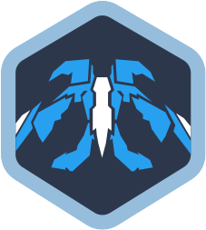

# 🎮 Cosmicrafts Command Center Dashboard

<div align="center">



**A Web3-enabled dashboard for managing your Cosmicrafts gaming experience on the Internet Computer**

[](LICENSE)
[](https://vuejs.org/)
[](https://www.typescriptlang.org/)
[](https://internetcomputer.org/)

[Features](#-features) • [Tech Stack](#-tech-stack) • [Getting Started](#-getting-started) • [Architecture](#-architecture) • [Contributing](#-contributing)

</div>

---

## 📋 Overview

The **Cosmicrafts Command Center** is a Web3 dashboard built for the Cosmicrafts gaming ecosystem. It provides a unified interface for players to manage their digital assets, track performance statistics, participate in tournaments, and interact with the game's blockchain infrastructure on the Internet Computer Protocol (ICP).

This application bridges multiple blockchain ecosystems, supporting authentication through various wallet providers and enabling seamless interaction with ICRC1 (fungible tokens) and ICRC7 (NFTs) standards.

## ✨ Features

### 🔐 Multi-Wallet Authentication
- **Internet Identity** - Native ICP authentication
- **NFID** - Secure, user-friendly ICP wallet
- **Google OAuth** - Traditional web2 onboarding
- **MetaMask** - Ethereum wallet integration with signature-based authentication
- **Phantom** - Solana wallet integration with cross-chain support

### 💰 Digital Asset Management
- **Token Dashboard** - View and manage ICRC1-compliant fungible tokens
- **Token Transfers** - Send tokens to other principals with fee calculation
- **Balance Tracking** - Real-time balance updates with proper decimal formatting
- **Metadata Display** - Comprehensive token information including name, symbol, and custom metadata

### 🖼️ NFT Management
- **NFT Gallery** - Browse your ICRC7-compliant NFT collection
- **Metadata Viewer** - Detailed NFT attributes and properties
- **Cross-canister Support** - Interact with multiple NFT collections

### 📊 Player Statistics
- **Overall Performance** - Aggregate stats across all games
- **Average Metrics** - Per-game performance indicators
- **Game Mode Analytics** - Performance breakdown by game mode
- **Faction Statistics** - Win rates and games played per faction
- **Character Analytics** - Performance metrics for each character
- **Combat Metrics** - Detailed damage, energy, and XP tracking

### 🏆 Tournament System
- **Tournament Browser** - View all active and upcoming tournaments
- **Tournament Creation** - Create custom tournaments with prize pools
- **Match Tracking** - Monitor tournament progress and results
- **Prize Pool Management** - Transparent reward distribution

### 👤 User Profile Management
- **Player Dashboard** - Centralized view of player information
- **Principal ID Display** - Blockchain identity management
- **Session Persistence** - Secure local storage of authentication state

## 🛠️ Tech Stack

### Frontend Framework
- **Vue 3** (v3.5.22) - Progressive JavaScript framework with Composition API
- **TypeScript** (v5.9.3) - Type-safe development
- **Vite** (v7.1.10) - Next-generation frontend build tool
- **Vue Router** (v4.6.0) - Official routing solution
- **Pinia** (v3.0.3) - Intuitive state management

### Blockchain Integration
- **@dfinity/agent** (v3.3.0) - ICP agent for canister communication
- **@dfinity/auth-client** (v3.3.0) - Authentication with Internet Identity and NFID
- **@dfinity/identity** (v3.3.0) - Identity and key management
- **@dfinity/principal** (v3.3.0) - Principal ID handling
- **@dfinity/candid** (v3.3.0) - Candid interface definition language support

### Wallet & Crypto Libraries
- **@solana/web3.js** (v1.98.4) - Solana blockchain interaction
- **tweetnacl** (v1.0.3) - Cryptographic operations
- **base64-arraybuffer** (v1.0.2) - Binary data encoding

### Development Tools
- **Sass** (v1.93.2) - CSS preprocessor
- **Prettier** (v3.6.2) - Code formatting
- **Dotenv** (v17.2.3) - Environment variable management
- **VueUse** (v13.9.0) - Collection of Vue composition utilities

## 🚀 Getting Started

### Prerequisites

- **Node.js** (v16 or higher)
- **npm** or **yarn** package manager
- Active Internet Computer canister deployments
- Environment variables configured (see below)

### Installation

1. **Clone the repository**
   ```bash
   git clone https://github.com/yourusername/dashboard.git
   cd dashboard
   ```

2. **Install dependencies**
   ```bash
   npm install
   # or
   npm run setup
   ```

3. **Configure environment variables**

   Create a `.env` file in the root directory:
   ```env
   # Google OAuth
   VITE_GOOGLE_CLIENT_ID=your_google_client_id
   
   # ICP Canister IDs
   VITE_CANISTER_ID_TOURNAMENTS=your_tournaments_canister_id
   VITE_CANISTER_ID_COSMICRAFTS=your_cosmicrafts_canister_id
   VITE_CANISTER_ID_ICRC7=your_nft_canister_id
   VITE_CANISTER_ID_PLAYER=your_player_canister_id
   VITE_CANISTER_ID_STATISTICS=your_statistics_canister_id
   VITE_CANISTER_ID_ICRC1=your_token_canister_id
   ```

4. **Start the development server**
   ```bash
   npm start
   ```
   The application will be available at `http://localhost:3000`

5. **Build for production**
   ```bash
   npm run build
   ```

### Project Structure

```
dashboard/
├── public/                    # Static assets
│   ├── favicon.svg
│   └── logo2.svg
├── src/
│   ├── assets/               # Images, logos, and icons
│   ├── components/           # Reusable Vue components
│   │   ├── Match.vue
│   │   ├── MetadataItem.vue
│   │   ├── TournamentSection.vue
│   │   └── UserInfo.vue
│   ├── declarations/         # Auto-generated Candid type definitions
│   │   ├── chests/
│   │   ├── cosmicrafts/
│   │   ├── flux/
│   │   ├── icrc1/           # Fungible token standard
│   │   ├── icrc7/           # NFT standard
│   │   ├── matchmaking/
│   │   ├── player/
│   │   ├── rewards/
│   │   ├── statistics/
│   │   ├── tournaments/
│   │   └── validator/
│   ├── router/              # Vue Router configuration
│   │   └── index.ts
│   ├── services/            # Business logic and API calls
│   │   ├── CommonTokenService.ts
│   │   ├── CosmicraftsService.ts
│   │   ├── MetaMaskService.ts
│   │   ├── PhantomService.ts
│   │   ├── StatisticsService.ts
│   │   ├── TokenService.ts
│   │   └── UserService.ts
│   ├── store/               # Pinia state management
│   │   ├── auth.ts         # Authentication and identity
│   │   ├── cosmicraftsStore.ts
│   │   ├── nftStore.ts
│   │   ├── playerStore.ts
│   │   ├── statisticsStore.ts
│   │   ├── tokenStore.ts
│   │   └── tournamentStore.ts
│   ├── utils/               # Utility functions
│   │   ├── customStringify.js
│   │   ├── metadataParser.js
│   │   └── polyfills.js
│   ├── views/               # Page components
│   │   ├── DashboardView.vue
│   │   ├── HomeView.vue
│   │   ├── LoginView.vue
│   │   ├── NFTView.vue
│   │   ├── StatisticsView.vue
│   │   ├── TokenView.vue
│   │   ├── TournamentView.vue
│   │   └── UserView.vue
│   ├── App.vue              # Root component
│   ├── main.js              # Application entry point
│   └── index.scss           # Global styles
├── index.html               # HTML template
├── package.json             # Dependencies and scripts
├── tsconfig.json            # TypeScript configuration
├── vite.config.js           # Vite build configuration
└── README.md
```

## 🏗️ Architecture

### Authentication Flow

```
User Login → Wallet/Provider Selection → Signature/Approval
    ↓
Key Generation from Signature/OAuth
    ↓
Ed25519 Identity Creation → ICP Agent Initialization
    ↓
Actor (Canister) Instantiation → State Persistence
    ↓
Dashboard Access
```

### State Management

The application uses **Pinia** for state management with the following stores:

- **auth** - User authentication, identity, and canister actor management
- **tokenStore** - ICRC1 token balances and operations
- **nftStore** - ICRC7 NFT collections and metadata
- **statisticsStore** - Player performance metrics
- **tournamentStore** - Tournament data and management
- **playerStore** - Player profile information
- **cosmicraftsStore** - Game-specific data

### Canister Communication

All blockchain interactions use the ICP Agent pattern:
1. Identity verification through Ed25519KeyIdentity
2. HttpAgent creation with user identity
3. Actor instantiation with Candid interface definitions
4. Type-safe method calls to canisters

## 🔒 Security Considerations

- **Private keys** are never transmitted; generated client-side from signatures
- **Session persistence** uses localStorage with proper cleanup on logout
- **HTTPS enforcement** for production deployments
- **Principal-based authorization** for all canister calls
- **Input validation** on all user-submitted data

## 🧪 Development Scripts

```bash
# Install dependencies
npm run setup

# Start development server (port 3000)
npm start

# Build for production
npm run build

# Format code with Prettier
npm run format
```

## 🌐 Supported Networks

- **Internet Computer** (Mainnet) - Primary blockchain
- **Ethereum** (via MetaMask) - Cross-chain authentication
- **Solana** (via Phantom) - Cross-chain authentication

## 📝 Environment Variables

| Variable | Description | Required |
|----------|-------------|----------|
| `VITE_GOOGLE_CLIENT_ID` | Google OAuth client ID | Yes |
| `VITE_CANISTER_ID_TOURNAMENTS` | Tournaments canister ID | Yes |
| `VITE_CANISTER_ID_COSMICRAFTS` | Main game canister ID | Yes |
| `VITE_CANISTER_ID_ICRC7` | NFT canister ID | Yes |
| `VITE_CANISTER_ID_PLAYER` | Player management canister ID | Yes |
| `VITE_CANISTER_ID_STATISTICS` | Statistics tracking canister ID | Yes |
| `VITE_CANISTER_ID_ICRC1` | Token canister ID | Yes |

## 🤝 Contributing

Contributions are welcome! Please follow these guidelines:

1. **Fork the repository**
2. **Create a feature branch** (`git checkout -b feature/amazing-feature`)
3. **Commit your changes** (`git commit -m 'Add amazing feature'`)
4. **Push to the branch** (`git push origin feature/amazing-feature`)
5. **Open a Pull Request**

### Code Style

- Follow the existing code structure
- Use TypeScript for type safety
- Run `npm run format` before committing
- Write descriptive commit messages

## 📄 License

This project is licensed under the MIT License - see the [LICENSE](LICENSE) file for details.

## 🙏 Acknowledgments

- **Internet Computer Foundation** - For the ICP blockchain infrastructure
- **DFINITY** - For the comprehensive SDK and tools
- **World of Unreal** - Game development team
- **Vue.js Team** - For the excellent frontend framework

## 📞 Support & Contact

For questions, issues, or contributions, please:
- Open an issue on GitHub
- Visit [Cosmicrafts official website](https://cosmicrafts.com)

---

<div align="center">

**Built with ❤️ by the Cosmicrafts Team**

© 2023 World of Unreal. All trademarks referenced herein are the properties of their respective owners.

</div>
